<div align="center">
  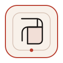
  <h1>Folio</h1>
  <p><b>值得留存的文档版式。</b></p>
  <p><sub>Folio fork 自 <a href="https://github.com/tw93/Kami">Kami</a>，并在此基础上扩展成一套面向 agent 生成交付物的文档设计系统。</sub></p>
  <a href="LICENSE"></a>
</div>

<p align="center">
  <a href="index-zh.html">
    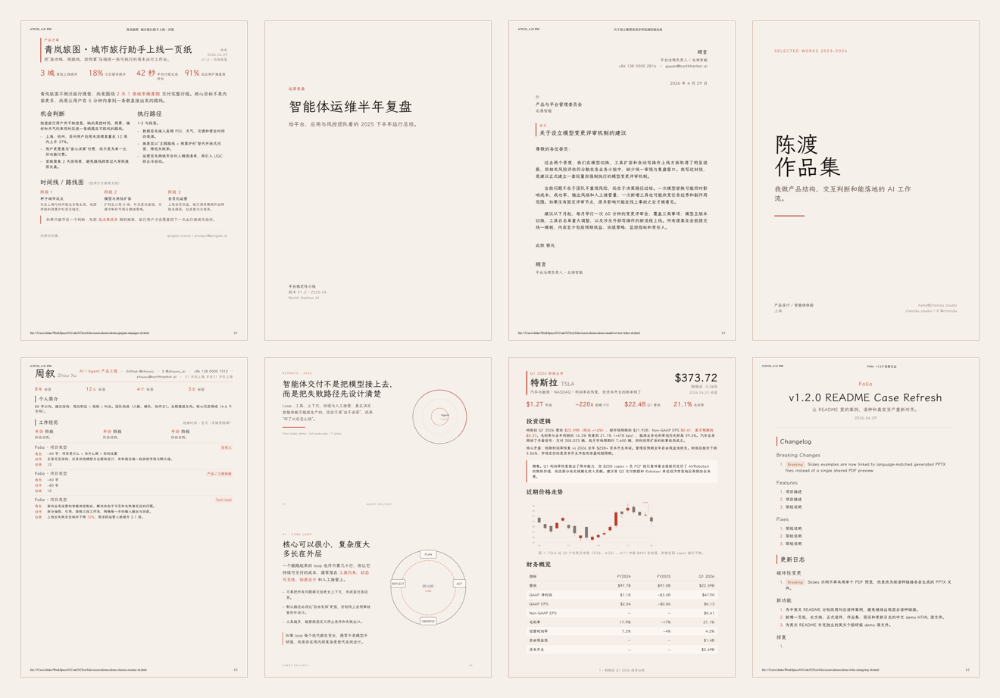
  </a>
</p>

<p align="center">
  <a href="index-zh.html"><b>视觉展厅</b></a> ·
  <a href="assets/demos/"><b>全部案例</b></a> ·
  <a href="README.md"><b>English</b></a>
</p>

## 先看效果，再看说明

Folio 是一套面向 AI 时代的文档设计系统：覆盖 8 种文档类型、23 种由 Drawing DSL 驱动的图表类型、中英文两条生成路径，并提供由同一套 profile 生成的 Web 阅读页，专门服务于 agent 驱动的交付物。

它追求的不是视觉花样，而是稳定、清晰、专业、可重复的输出结果。

Folio 不把文档视为中性的输出，而把它看作思想获得公共形体、可读性与留存性的方式。暖米纸底让页面慢下来，serif 让判断有声音，朱砂色标出真正重要之处，留白则保护读者的注意力。

完整项目文本见英文版 [references/manifesto.md](references/manifesto.md) 与中文版 [MANIFESTO.zh-CN.md](MANIFESTO.zh-CN.md)。

第一次打开仓库，最值得先感受到的是：

- 同一套设计语言如何覆盖 8 种文档类型
- 23 种结构化图表如何输出 `SVG + PNG + PDF`
- 中文和英文输出如何共享一致的排版气质
- Web 阅读页（系列索引与模块存档）与其他输出共用同一套 profile，而不把 Folio 变成前端框架
- 成品默认落到 PDF / PPTX，而不是停留在 HTML 示意图
- 一页纸、研报、简历、幻灯片、更新日志之间如何保持统一而不单调

## 文档样本墙

<table>
  <tr>
    <td width="50%" valign="top">
      <a href="assets/demos/demo-qinglan-onepager-zh.pdf">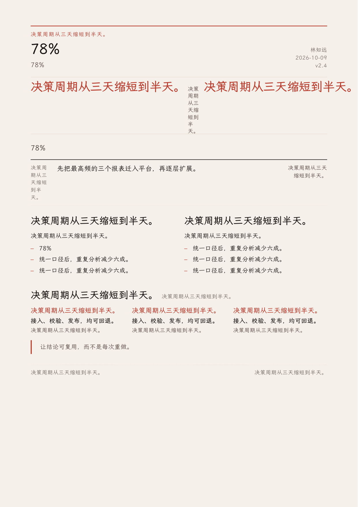</a><br>
      <b>One-Pager</b><br>
      上线简介、提案、执行摘要。
    </td>
    <td width="50%" valign="top">
      <a href="assets/demos/demo-agent-ops-longdoc-zh.pdf"></a><br>
      <b>Long Doc</b><br>
      白皮书、复盘、技术报告。
    </td>
  </tr>
  <tr>
    <td width="50%" valign="top">
      <a href="assets/demos/demo-model-review-letter-zh.pdf"></a><br>
      <b>Letter</b><br>
      正式信件、备忘录、声明。
    </td>
    <td width="50%" valign="top">
      <a href="assets/demos/demo-chendu-portfolio-zh.pdf"></a><br>
      <b>Portfolio</b><br>
      作品集、案例集、精选项目。
    </td>
  </tr>
  <tr>
    <td width="50%" valign="top">
      <a href="assets/demos/demo-zhouxu-resume-zh.pdf">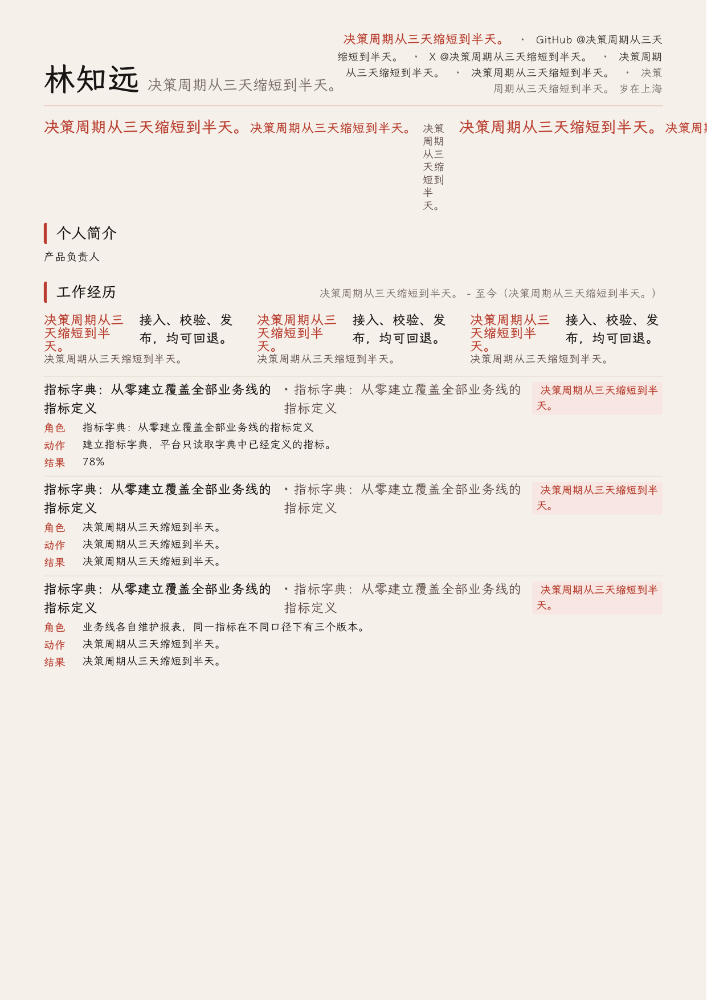</a><br>
      <b>Resume</b><br>
      简历、职业履历。
    </td>
    <td width="50%" valign="top">
      <a href="assets/demos/demo-agent-slides-zh.pdf">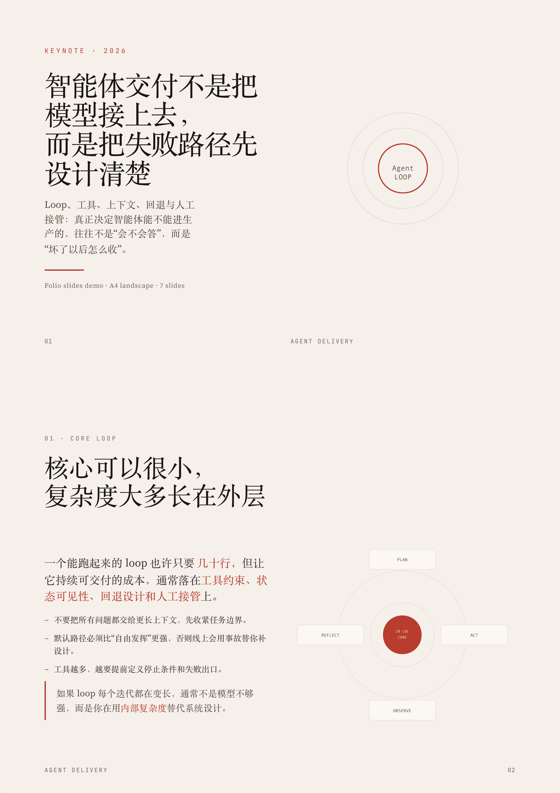</a><br>
      <b>Slides</b><br>
      演讲稿、Keynote、内部汇报。
    </td>
  </tr>
  <tr>
    <td width="50%" valign="top">
      <a href="assets/demos/demo-tesla.pdf">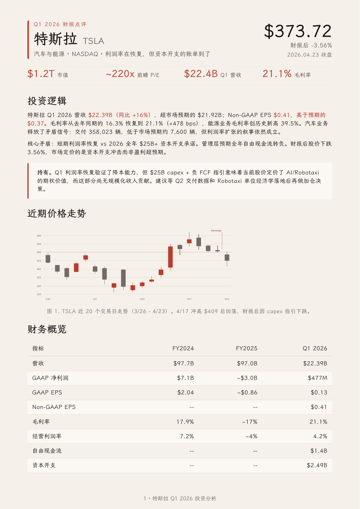</a><br>
      <b>Equity Report</b><br>
      投资备忘录、财报快报、个股研报。
    </td>
    <td width="50%" valign="top">
      <a href="assets/demos/demo-folio-changelog-zh.pdf">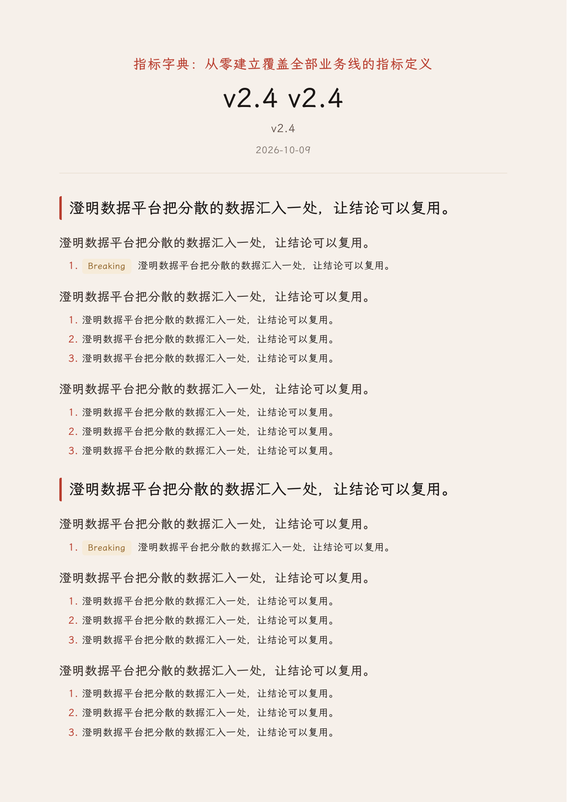</a><br>
      <b>Changelog</b><br>
      更新日志、版本说明、Release Notes。
    </td>
  </tr>
</table>

## 图形 Artifact 案例

<table>
  <tr>
    <td width="33.33%" valign="top">
      <a href="assets/demos/demo-architecture.pdf">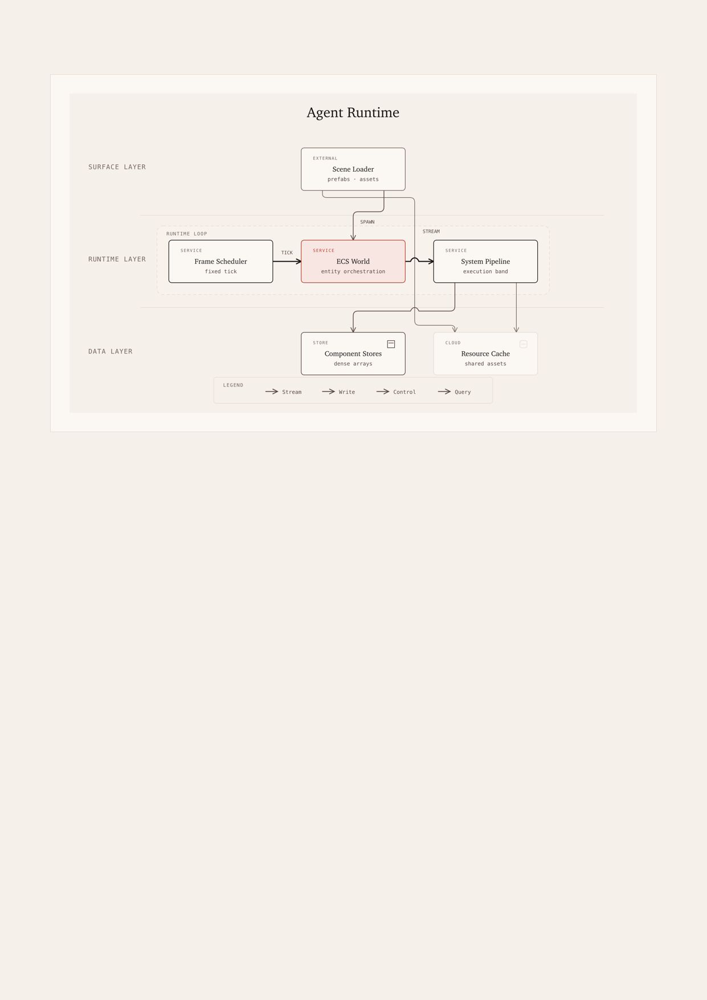</a><br>
      <b>Agent Runtime</b><br>
      请求驱动运行时案例：覆盖网关入口、任务规划、模型执行、工具调用、检索内存和可观测性。
    </td>
    <td width="33.33%" valign="top">
      <a href="assets/demos/demo-workflow-engine.pdf">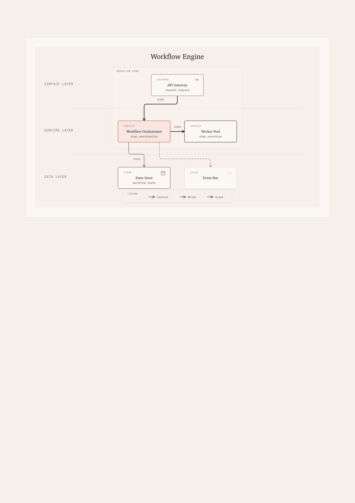</a><br>
      <b>Workflow Engine</b><br>
      工作流编排案例：覆盖入口接入、流程编排、Worker 执行、状态持久化和事件式延续。
    </td>
    <td width="33.33%" valign="top">
      <a href="assets/demos/demo-data-platform.pdf">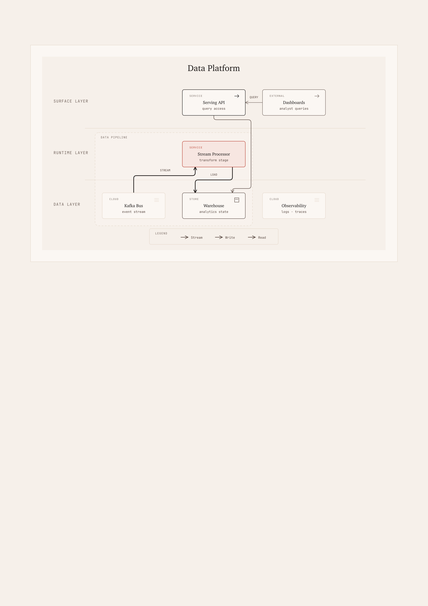</a><br>
      <b>Data Platform</b><br>
      策略化布局案例：用一套可复用 grammar 渲染管线主带、仓储服务和支撑读路径。
    </td>
  </tr>
  <tr>
    <td width="33.33%" valign="top">
      <a href="assets/demos/demo-uml-class.pdf">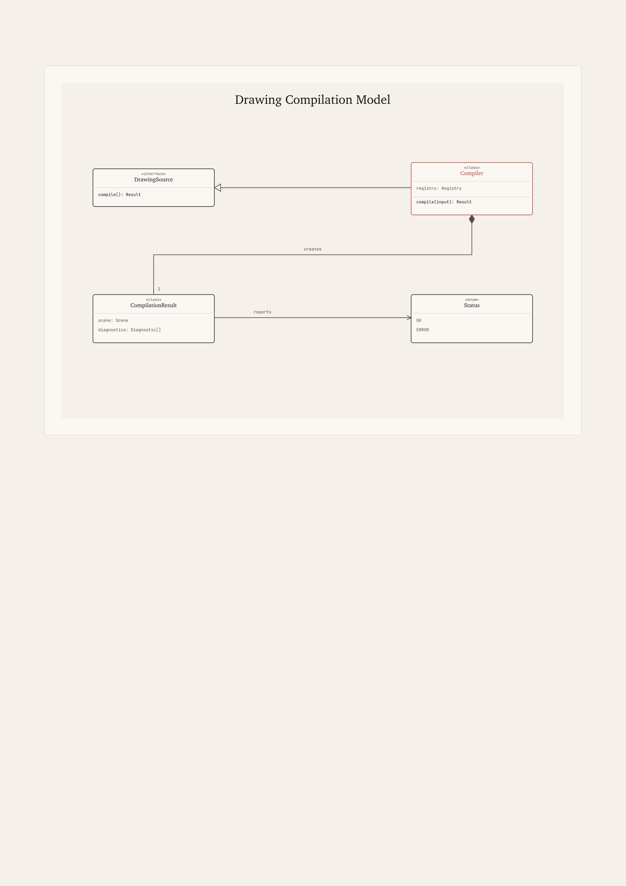</a><br>
      <b>Agent Session Model</b><br>
      UML 领域模型案例：覆盖接口、枚举生命周期、组合、聚合，以及检索记忆关联。
    </td>
    <td width="33.33%" valign="top">
      <a href="assets/demos/demo-flowchart-v2.pdf">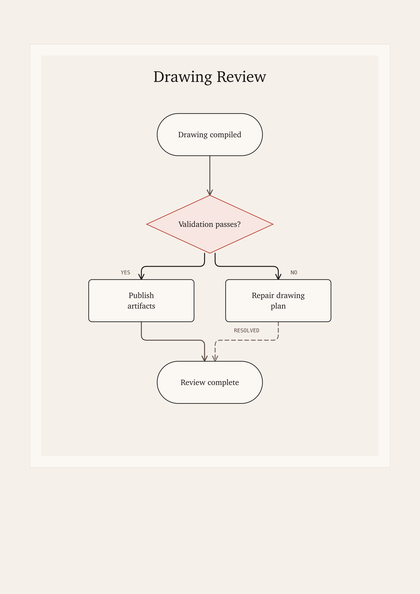</a><br>
      <b>Drawing Review Flow</b><br>
      Drawing DSL 案例：覆盖类型化决策、分支标签、正交路由和可访问 SVG 元数据。
    </td>
  </tr>
</table>

## 完整图表目录

23 种类型全部由生成器驱动：架构图、流程图、状态机、泳道图、树图、分层堆栈、时间线、四象限、韦恩图、金字塔、组织架构、飞轮循环、柱状图、折线图、环形图、K 线图、瀑布图、散点图、甘特图、热力图、时序图、UML 类图、ER 图。

<p align="center">
  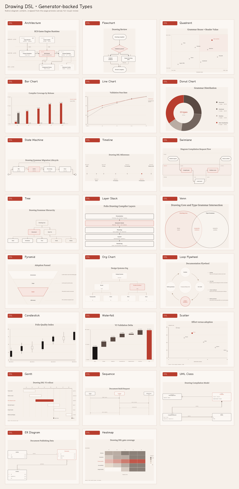
</p>

这张接触表由程序渲染生成，不是手工拼接。重新生成并与已批准的视觉基线比对：

```bash
python3 scripts/folio.py diagram-catalog
python3 scripts/folio.py diagram-catalog --baseline references/fixtures/drawing/catalog-baseline-v3.json
```

## 从输入到输出

1. 从原始内容、草稿、笔记、来源链接，或一句像 `帮我做一份一页纸` 这样的请求开始。
2. Folio 先判断合适的文档类型和语言路径，再把内容蒸馏成模板可承接的结构。
3. 最终输出稳定的 PDF 或 PPTX，保留 Folio 的暖纸底、serif 层级和克制朱红焦点。
4. 如果请求的是 23 种官方图表之一，也可以直接落成可复用的 `SVG + PNG + PDF` artifact。

## 快速开始

**CLI**

需要 Python 3.10 或更高版本；`requirements-ci.txt` 固定了验证使用的 Python 依赖。

使用 `scripts/folio.py` 作为稳定的项目入口：

```bash
python3 scripts/folio.py doctor
python3 scripts/folio.py list-targets
python3 scripts/folio.py check
python3 scripts/folio.py build resume-en
python3 scripts/folio.py verify resume-en
python3 scripts/folio.py package
```

新机器上先运行 `doctor`。它会检查 WeasyPrint 原生库、PDF 工具、图形导出工具、PPTX 支持和中文字体是否就绪，避免把环境问题误判成模板问题。

**Claude Desktop**

先执行 `bash scripts/package-skill.sh` 构建 `dist/folio.zip`，再打开 Customize > Skills > "+" > Create skill 上传 ZIP。该 ZIP 是构建产物，仓库不再跟踪它。

**通用 agent 环境**（Codex、OpenCode、Pi，以及其他读取 `~/.agents/` 的工具）

可以先自行打包 ZIP 做本地安装；如果后续要发布，再把仓库放到你自己的命名空间下。

Folio 会根据自然语言请求自动触发。你只需要尽量把下面这些信息讲清楚：

- 想要的文档类型
- 使用的语言
- 原始内容、笔记、草稿或素材
- 必须保留的事实、数字或来源链接
- 相关品牌素材：logo、截图、产品图、品牌色
- 会影响输出的额外要求：PDF、PPTX、PNG、对外稿、内部备忘录

示例提示词：

- `帮我做一份一页纸`
- `帮我排版一份长文档`
- `帮我写一封正式信件`
- `帮我做一份作品集`
- `帮我做一份简历`
- `帮我做一套演讲幻灯片`
- `帮我写一份英伟达个股研报`
- `帮我整理更新日志`
- `帮我生成一张系统架构图`
- `帮我画一张 UML 类图`
- `帮我把这份报告设计成网页阅读页`

可选：创建 `~/.config/folio/brand.md`，持久保存身份信息、文档默认设置和写作习惯。可从 [brand.example.md](references/brand.example.md) 开始。当前请求存在歧义时，Folio 会把它作为 fallback 上下文使用。

模板位于 `assets/templates/`。`assets/demos/` 只保留渲染后的 `PDF + PNG` 展示资产，这样 README 可以直接展示真实成品，而不是在 Markdown 里重复实现首页的布局逻辑。

## 核心能力

### 类型路由

Folio 会在 8 种文档类型和 2 条语言路径之间自动路由。

- 中文请求路由到 `*.html` 或 `slides.py`
- 英文请求路由到 `*-en.html` 或 `slides-en.py`
- Slides 的源模板是 Python，不是 HTML

### 内容蒸馏

Folio 不要求输入必须先整理成干净提纲，也能把原始材料收束成成型文档。

- 会议笔记、信息 dump、聊天记录、散乱 bullet 都可以蒸馏成适配模板的结构
- 简历和作品集会被收紧到更强调可量化结果的写法
- 研报和更新日志会被推向证据优先的写法，而不是泛泛总结

### 来源与素材检查

Folio 把“当前事实”和“品牌素材”当作一等输入，而不是补充信息。

- 涉及当前事实时，默认先看可靠来源再写
- 涉及品牌文档时，会检查 logo、截图、产品图和品牌色是否齐备
- 如果关键素材缺失，应明确标出缺口，而不是用泛化视觉凑数

### Web 阅读页

Folio 把一组内容片段构建成静态阅读页：一个系列索引，加上每篇文章的模块页。排版 PDF 的那套 profile 同样排版屏幕；变的是介质，不是设计系统。

**写什么。** 一个系列就是一个目录：

```text
references/fixtures/web/attention/
  series.json          身份、语言、页面类型、图表清单与图注
  attention.frag.html  模块正文：章节与其内容
  source.txt           页面不得删减的原文
  figures/*.json       每张图一个 Drawing DSL fixture
```

`series.json` 声明语言，页面据此带上 `lang`、选择中文或英文的排版 profile，并决定界面文案。片段只放内容：没有 `<head>`、没有导航、没有样式。

**构建出什么。** `dist/web/` 下有一份共享的 `fonts/`，以及每个系列一个目录。系列目录里是 `index.html`（系列索引）、`<module>/index.html`（模块存档）、`plan.json`（版式算术）和 `figures.manifest.json`（每块图版的档位、外框与实际交付字号）。页面是自包含的：一个由 profile 投影出来的 `<style>`，没有外链样式或脚本文件，没有应用外壳，阅读时不跑构建。只有右侧章节刻度的滚动激活是几行内联脚本；交付合同统计的是外部文件，而页面没有任何外部文件。

**怎么排版。** 屏幕字号角色、字体栈、间距、圆角、行长与页面几何在 `references/profiles/web/folio-v1.yaml`；颜色以角色形式来自主题 profile，页面里不写十六进制。`projection.py` 把它们作为自定义属性写进页面的 `<style>`，`assets/templates/web/base.css` 只读取这些变量。两道闸门从两侧执行同一条规则：`scripts/projection.py check` 读模板源文件，`check_web.py`（W-DEN-08/09）读构建后的页面。

**图表。** 图表按它将被展示的宽度带构图，而不是把 960 单位的成品缩小。每张图按四个宽度类（`narrow`、`compact`、`medium`、`wide`）各输出一次内联 SVG，带上档位、外框尺寸与 fixture sha；CSS 只显示当前视口对应的那一块。只有 `STAGE_AWARE` 中的家族允许在其他档位编译，`compose_for_band()` 选择能让最小字号不低于 7px 下限的最大档位。一个 stage-aware 家族如果没有任何档位能构图，会让 plan 闸门失败，而不是悄悄回退到 960 成品图版。

页面只有两种身份：

- **案例（case）** 是内容。它注明所读的作品（作品、作者、年份、链接），不描述排版它的引擎。
- **夹具（fixture）** 是引擎的一致性页面：带交付状态与包路径，存在的目的就是测试规则。

```bash
python3 scripts/folio.py web --series references/fixtures/web/attention
python3 scripts/folio.py web --series references/fixtures/web/attention \
  --verify --level 3 --source references/fixtures/web/attention/source.txt
python3 scripts/web_plan.py --series attention --gate
python3 scripts/check_web.py dist/web/attention/attention/index.html --level 3
```

静态闸门用 Python 跑，不需要浏览器：L1 覆盖结构、文本、交付与图表合同，L2 加上声明的密度与颜色，L3 加上图版几何审计。实测闸门在每夜任务里跑，因为只有浏览器知道页面最终算出了什么：`scripts/web_measure.py` 报告版式，`scripts/web_verify.py` 按 `V-*` 规则与 `plan.json` 比对。规则、层级与验收表都在 `references/web/` 下。

这条路径不引入 Web 应用框架：没有组件库、路由、客户端状态或暗色模式开关。

### 图表路由

不需要自己先挑图表类型。描述表达意图，让 Folio 来路由。

```bash
python3 scripts/folio.py route-diagram --content "审批流程"
python3 scripts/folio.py route-diagram --content "各地区季度营收对比" --goal compare
```

8 个语义模式覆盖全部场景：`architecture`、`comparison`、`data`、`flow`、`hierarchy`、`relationship`、`state`、`time`。打分是确定性的，同一段描述总会落到同一种类型；每次决策都会返回胜出模式、置信区间、完整分数表、同模式内备选项和可读的推理轨迹。

### 图表主题与输出拨杆

主题和导出拨杆都在渲染层，不进入图表 payload。几何始终由编译器持有。

| 参数 | 取值 | 作用 |
|---|---|---|
| `--theme` | `folio` / `dark` / `terminal` | 配色与字体 profile，带对比度校验 |
| `--size` | `compact` / `standard` / `wide` | 仅影响位图导出宽度 |
| `--detail` | `essential` / `standard` / `full` | 网格线与标注密度 |
| `--audience` | `executive` / `general` / `practitioner` | 面向投影可读性的字号阶梯 |
| `--variant` | `plain` / `sketchy` / `motion` | 手绘描边滤镜或尊重 reduced-motion 的入场动效 |

```bash
python3 scripts/folio.py render-drawing references/fixtures/v3/bar-chart.json \
  --theme dark --size wide --detail essential --audience executive \
  --format png --output /tmp/bar.png
```

### 图表导入

已有的图表来源可以直接进入管线，不必重新手写。

```bash
python3 scripts/folio.py import-diagram references/fixtures/import/flowchart.mmd --output /tmp/flow.json
python3 scripts/folio.py import-chart-data references/fixtures/tabular/bar-import.json --output /tmp/bar.json
```

Mermaid 和 draw.io 会转换成类型化的图表 JSON，并附一份保真度台账，记录哪些信息被保留、哪些被丢弃。本地 CSV / TSV 会规范化成类型化的图表数据 JSON。

### 输出生成

Folio 目前支持这些输出路径：

- HTML 模板 -> PDF
- Python 幻灯片模板 -> PPTX
- Diagram spec -> SVG + PNG + PDF
- 阅读页系列 -> 自包含静态 HTML（`scripts/folio.py web`）

展示型 demo 通常会同时保留 `HTML + PDF + PNG`，这样首页和 README 才能持续反映真实状态。

### 基于 Cheatsheet 的快速编辑

Folio 不只是模板集合，还带了一份紧凑的操作参考：[CHEATSHEET.md](CHEATSHEET.md)。

- 需要最快路径时，看它拿 token、字号、间距、图表限制和常用 CSS 片段
- 需要完整视觉系统时，看 `references/design.md`
- 结构没问题但内容质量不够时，看 `references/writing.md`
- 构建、页数、渲染行为出问题时，看 `references/production.md`
- 需要静态 Web 阅读页时，看 `references/web/README.md`；它的样式来自与其他输出相同的主题与 Web profile

### 文档引擎

文档先经过语义模型生成，HTML 模板只是它的一个渲染器。

- `scripts/document_ir/` 存放这个模型：其中不出现字号、颜色、页边距或坐标，主题只按名称引用，绝不内联取值
- 兼容 Writer 填充模板自身的标记，而不是重新生成一份；模板的外观在于它的 DOM 结构，而不只是类名
- `FOLIO_PIPELINE` 选择渲染路径：`ir`（默认）、`ir-shadow`，以及用于回滚的 `legacy`
- PPTX 由同一个模型产出，幻灯片不再是独立的代码路径

关于文档的每一项结论都可以复核：

```bash
python3 scripts/fidelity.py measure          # IR 路径与模板路径对比，七类渲染一致（平均 SSIM 0.9887）
python3 scripts/corpus.py validate           # 197 个 fixture，覆盖四种书写系统
python3 scripts/document_baseline.py compare # 文档与已批准的基线一致
python3 scripts/migration.py status          # 各类文档的 IR 就绪度
```

### 色系

一个色系就是一个 YAML 文件。`FOLIO_THEME` 指定它，它会到达每一类产物：文档、图表、幻灯片、静态页面。

```bash
FOLIO_THEME=folio-slate-v1 python3 scripts/build.py               # 文档、图表、幻灯片
FOLIO_THEME=folio-slate-v1 python3 scripts/build_static_theme.py  # index.html 与 demo 页
```

不设置时，使用标记 `default` 的方案，**本项目就是用 `folio-classic-v1` 构建的**：仓库里每一个示例、图表、幻灯片和页面都是默认色系。另外两套是供选择时参考的样例，不是待定的改动 —— 选择权在采用者手上，不指定 `FOLIO_THEME` 就不会用到它们。全部定义在 `references/profiles/theme/`，一个文件就是一个完整色系：

- `palette` 存放原始色，每个只写一次。数字是明度阶梯上的位置：同族内编号越大越深，所以两个名字就能看出哪个更浅。
- `color` 存放模板读取的语义角色，指向色板。`color.text.primary` 按一条规则派生出 `--color-text-primary`，所以加角色只需想一个名字。

加一个色系就是加一个文件。每个色系都要过同一套标准：

```bash
python3 scripts/check_theme_schemes.py       # 角色、对比度、阶梯、可达性
python3 scripts/build_scheme_comparison.py   # 所有色系并排对照
python3 scripts/build_color_reference.py     # 单个色系的色板与角色
```

色系不仅作用于画布，也作用于图表的系列色：绘图主题读取 `color.series.1` … `color.series.6`，其中折线图描边的前三个位置有 3:1 的非文字对比度下限，因为它们是 1.6px 的描边。`docs/acceptance/theme-schemes.html` 是对照页。

同一份一页纸在三套色系下的渲染：

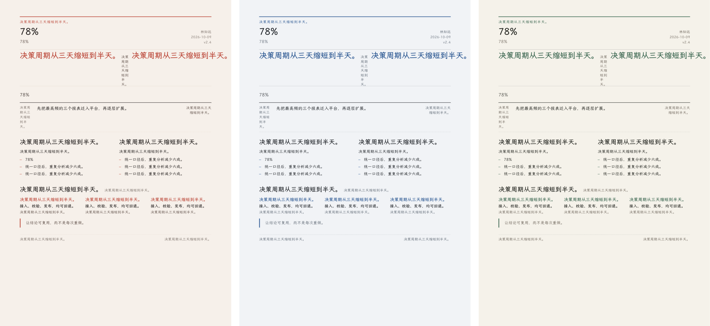`scripts/build_color_reference.py --theme <名字>` 生成任一色系自己的参考页。

## 排版规则

这些是最值得守住的最低规则集。

1. 页面底色使用所选色系的画布色，不要用纯白。默认色系是 parchment `#F6F0EA`。
2. 全文只保留一个强调色，即色系的 `color.accent.brand`。默认色系是 cinnabar-coral `#B83D2E`。
3. 默认一页一套 serif，除非模板本身已经定义了其他视觉语言。
4. Serif 正文保持 400，标题保持 500，避免 synthetic bold。
5. 中文印刷正文通常带少量字距，英文正文保持 0。
6. Tag 背景必须使用实色 hex，不要用 `rgba()`，否则 WeasyPrint 可能渲染出双层矩形。
7. 层次感来自 ring shadow、whisper shadow 或明暗切换，不用硬投影。
8. 必须守住各文档类型的页数契约，尤其是简历和一页纸。

## 设计参考

先看短参考，需要时再深入。

- [CHEATSHEET.md](CHEATSHEET.md)：快速参考
- [references/design.md](references/design.md)：视觉系统
- [references/writing.md](references/writing.md)：内容策略与质量标准
- [references/production.md](references/production.md)：构建、验证与排障
- [references/diagrams.md](references/diagrams.md)：内联 SVG 图表规则
- [references/drawing-dsl.md](references/drawing-dsl.md)：Drawing DSL 范围、编译阶段、路由与输出层
- [references/drawing-dsl-authoring.md](references/drawing-dsl-authoring.md)：意图优先的图表创作流程
- [references/drawing-dsl-v6-final-audit.md](references/drawing-dsl-v6-final-audit.md)：收尾审计、门禁证据与已知限制
- [references/web/README.md](references/web/README.md)：Web 阅读页场景、交付、图表与验收
- [references/profiles/web/folio-v1.yaml](references/profiles/web/folio-v1.yaml)：屏幕字体栈、字号阶梯、间距、圆角与行长
- [CHANGELOG.md](CHANGELOG.md)：版本亮点汇总，附 `docs/releases/` 中完整发布说明的链接

## 生图提示词

Folio 也可以作为图片模型或绘图工具的风格 brief。把 `references/` 交给它们，并明确要求遵守 Folio 的暖纸底色、朱红克制、serif 层级和编辑式留白。

示例插图 brief：

<table>
  <tr>
    <td width="33.33%" valign="top" align="center">
      <br>
      高山夜行列车旅行图册：站点注释、时刻卡片、暖纸底和手工批注并存
    </td>
    <td width="33.33%" valign="top" align="center">
      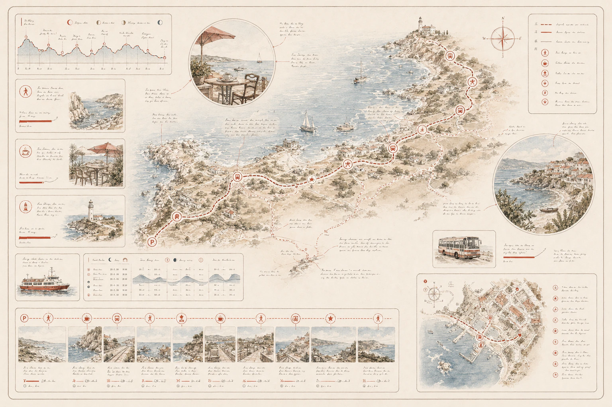<br>
      海岸周末路线海报：潮汐时间窗、咖啡停靠点、步行段与换乘点清晰分层
    </td>
    <td width="33.33%" valign="top" align="center">
      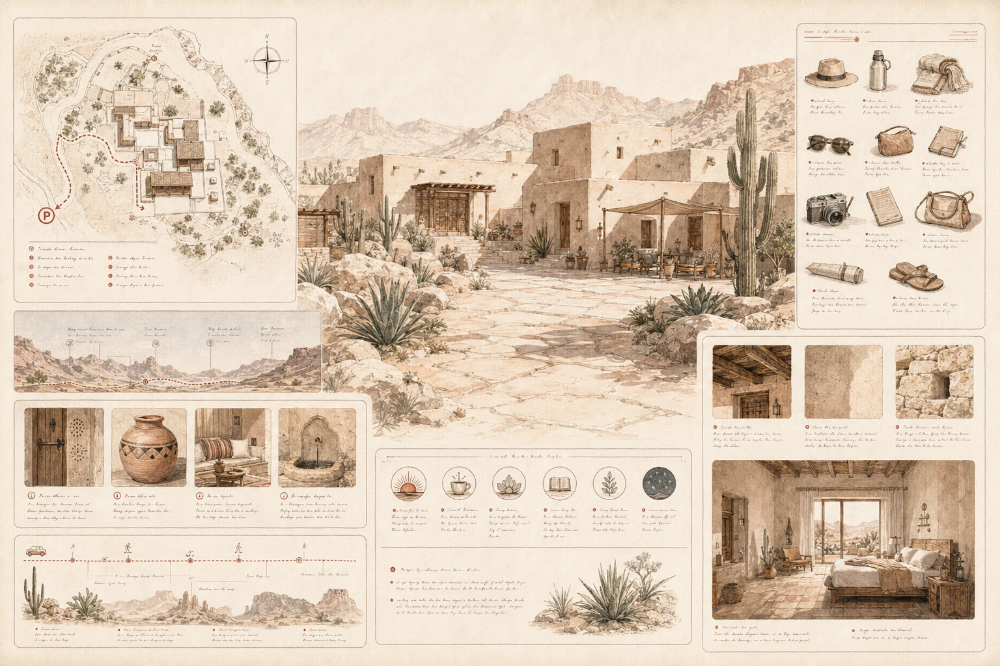<br>
      沙漠设计酒店旅行手账：到达地图、打包提示、物件特写与留白并置
    </td>
  </tr>
</table>

## 支持

- 如果发现 bug、措辞漂移或版式回归，欢迎提 issue 或 PR。
- 代码和模板使用 MIT License。
- LXGW WenKai 为开源字体；Charter 依赖系统或开源可用性。
